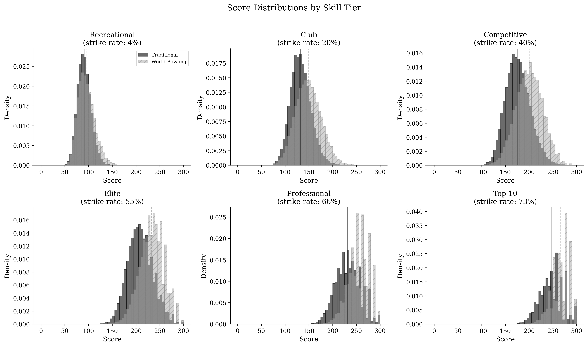
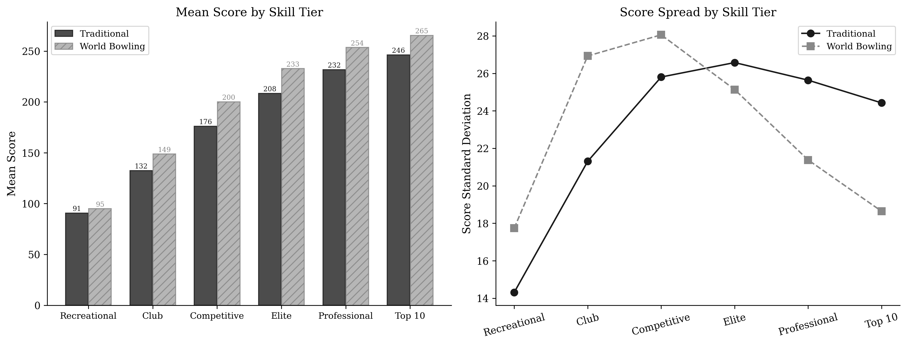
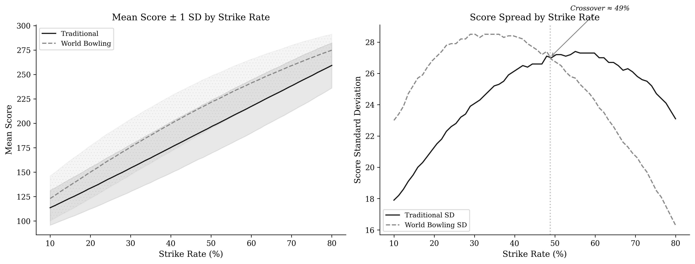
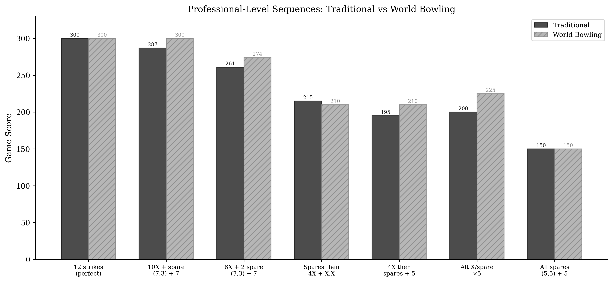

These results come from Monte Carlo simulations of 50,000 games per skill tier, using three progressively realistic models. For full details and the ability to re-run with your own parameters, see the [Colab notebooks](https://colab.research.google.com/github/michael-borck/skill-sequence-scoring/blob/main/notebooks/01_paper_results.ipynb).

## Skill Tiers

We simulate six skill levels, calibrated against USBC and PBA statistics:

| Tier | Strike Rate | Traditional Mean | World Bowling Mean |
|---|---|---|---|
| Recreational | 4% | ~91 | ~95 |
| Club | 20% | ~133 | ~149 |
| Competitive | 40% | ~176 | ~200 |
| Elite | 55% | ~209 | ~233 |
| Professional | 66% | ~232 | ~253 |
| Top 10 | 73% | ~246 | ~265 |

## Score Distributions by Tier

Notice how the distributions shift and compress differently under each system. At the recreational level, both systems produce similar shapes. At the professional level, World Bowling scores compress toward 300 while traditional scores maintain a wider spread.

## The Crossover Point — and What It Does Not Mean

The score-spread curves cross at a strike rate of **48.7%** (95% bootstrap CI 48.2–49.1%).

- **Below the crossover** (recreational, club): World Bowling provides *more* score spread.
- **Above the crossover** (elite, professional): traditional scoring provides *more* spread — over 30% more at the Top 10 level.

The standard deviation lines cross between the Competitive and Elite levels.

It is tempting to read this as a crossover in *discrimination* — as if World Bowling separates players better below 50% and traditional scoring better above it. That reading is wrong. Standard deviation measures how wide the score distribution is, not how much of that width reflects genuine differences in player ability. The next section decomposes the spread into signal and noise.

## Signal versus Noise

We treat each scoring system as a measurement instrument and estimate its single-game reliability: the fraction of one game's score variance attributable to real differences between players, rather than game-to-game noise.

The two systems have statistically indistinguishable single-game reliability at every competitive, professional and elite skill level. Traditional scoring's larger spread at elite levels is mostly *within-player* noise: the amplifying bonus structure inflates signal and noise together, leaving their ratio essentially unchanged.

So where does commutativity actually cost something? In measuring *how* a player arranges a fixed number of strikes. At a fixed 66% strike rate, a player's mean traditional score correlates with true streakiness at **r = 0.49** (95% CI 0.37–0.60), while the World Bowling correlation is **r = −0.04** (95% CI −0.20–0.12), indistinguishable from zero.

World Bowling is not merely noisier at detecting streakiness; it is structurally incapable of detecting it, exactly as commutativity requires.

## Compounding over a Series

The per-game streakiness effect is moderate (Cohen's *d* = 0.23), but competition is decided over multi-game blocks. An independent per-game advantage compounds: the expected total-score gap grows linearly with the number of games while its standard deviation grows only as the square root, so the series-level effect size grows as √n.

Under traditional scoring, a maximally streaky player's probability of winning a head-to-head series against a streak-free player of identical skill rises from 57% over one game to 67% over six games and about 90% over 48 games. Under World Bowling, the same player's win probability stays near chance (53% even at 48 games). These are upper bounds: they contrast the extremes of the swept streakiness range, and the real population dispersion of streakiness is not yet established.

## Robustness: Three Simulation Models

Does the finding hold if we make the simulation more realistic? We tested three models:

1. **Independent** — each ball is statistically independent (base case)
2. **Momentum** — strike probability shifts ±5% based on the previous frame
3. **Markov chain + spare difficulty** — state-dependent strike probabilities calibrated from PBA data, with leave-dependent spare conversion rates

All three models agree on the *direction* of the spread effect at every tier. The magnitude is model-sensitive: the momentum model amplifies the gap, while the Markov model is close to independence at the top tier. The independent model is not uniformly conservative, so we use it as the reference case rather than as a lower bound.

## Professional-Level Sequences

At the professional level, specific game sequences show large score differences between the systems. The systems agree at the extremes (perfect game, all spares) but diverge substantially for the mixed sequences that make up real competitive bowling.

Key observation: four strikes followed by six spares scores 195 under traditional but 210 under World Bowling; spares followed by four strikes scores 215 traditional but 210 World Bowling. **Same frames, different order — traditional scoring encodes the difference, World Bowling erases it.**

## Want to explore further?

- **[Scoring Explorer](explorer.qmd)** — build your own frame sequences and see both scores live
- **[Reward Gradient](reward.qmd)** — see how the value of each consecutive strike changes
- **[Run on Colab](https://colab.research.google.com/github/michael-borck/skill-sequence-scoring/blob/main/notebooks/02_interactive_explorer.ipynb)** — adjust strike rates, spare rates, and model parameters with interactive sliders
